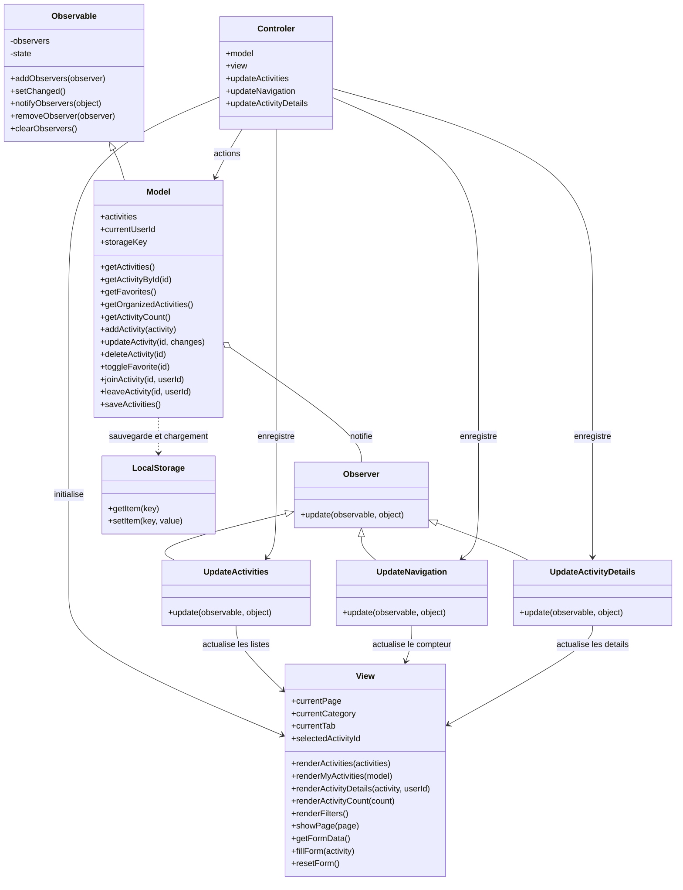
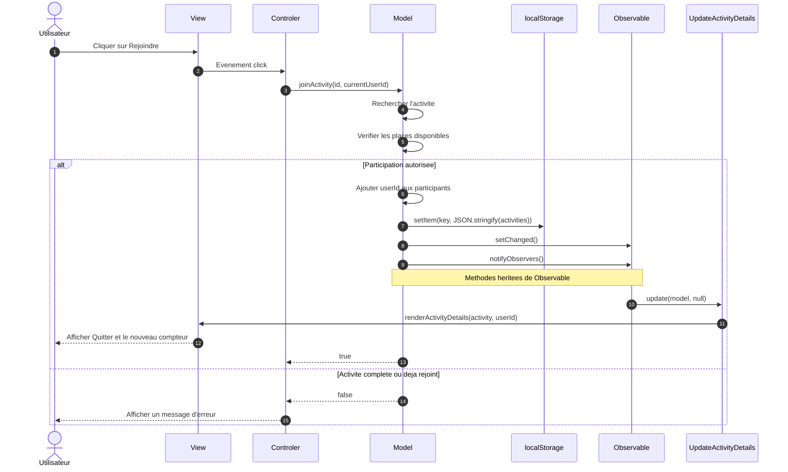
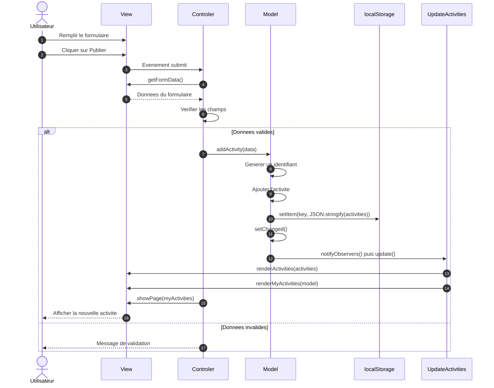

## Architecture MVC

CampusBreaks repose sur une architecture **Model–View–Controller (MVC)**, associée au patron de conception **Observer/Observable**.

Cette architecture sépare les responsabilités :

- **Model** : contient les activités et la logique métier (CRUD, favoris, participations et persistance).
- **View** : affiche les activités, les formulaires, les détails et la navigation.
- **Controler** : reçoit les actions de l'utilisateur et appelle les méthodes du modèle.
- **Observable** : notifie les observateurs lorsque les données changent.
- **Observer** : définit l'interface `update()` utilisée pour actualiser les vues.

### Diagramme d'architecture et de classes

### Fonctionnement du pattern Observer

Le modèle hérite de la classe `Observable`.

Lorsqu'une activité est créée, modifiée ou supprimée, ou lorsqu'un utilisateur modifie ses favoris ou sa participation :

1. Le contrôleur appelle la méthode correspondante du modèle.
2. Le modèle modifie ses données.
3. Le modèle sauvegarde les changements avec `saveActivities()`.
4. Le modèle appelle `setChanged()`.
5. Le modèle appelle `notifyObservers()`.
6. Les observateurs enregistrés reçoivent la notification via `update()`.
7. Les méthodes de la vue actualisent les éléments affichés.

Les trois observateurs spécialisés sont :

- **UpdateActivities** : actualise l'accueil et la rubrique Mes activités.
- **UpdateNavigation** : actualise le compteur global d'activités.
- **UpdateActivityDetails** : actualise les détails et le nombre de participants.

## Diagramme de séquence

### Cas d'utilisation : rejoindre une activité

Ce diagramme illustre le déroulement d'une participation, depuis le clic utilisateur jusqu'à l'actualisation de l'interface.

**Remarque :** le modèle hérite des méthodes d'`Observable`. Les appels à `setChanged()` et `notifyObservers()` sont donc exécutés sur l'instance du modèle. Le diagramme représente `Observable` séparément pour rendre le mécanisme plus lisible.

### Cas d'utilisation : créer une activité

## Avantages de l'architecture

- **Séparation des responsabilités** : chaque classe possède un rôle clairement défini.
- **Maintenabilité** : les changements d'interface n'imposent pas de modifier la logique métier.
- **Réutilisabilité** : plusieurs observateurs peuvent réagir à une même modification.
- **Synchronisation automatique** : les vues sont actualisées après notification du modèle.
- **Persistance** : les activités sont conservées localement grâce à `localStorage`.
